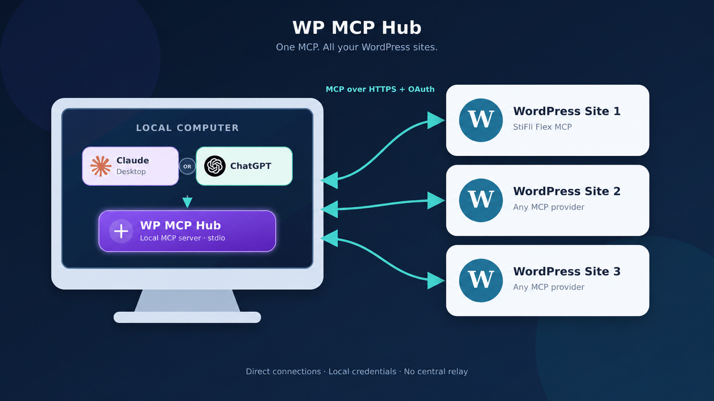
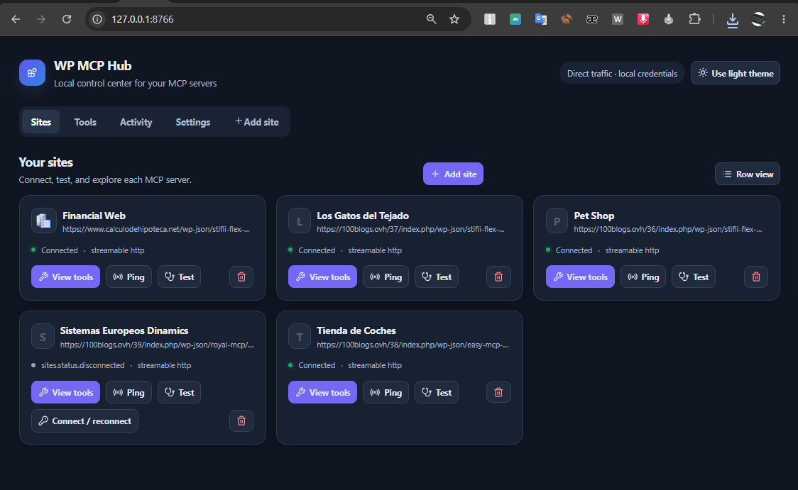

# WordPress MCP Hub

[](https://github.com/estebanstifli/wp-mcp-hub/actions/workflows/ci.yml)
[](https://www.python.org/)
[](LICENSE)

WordPress MCP Hub is a local, cross-platform [Model Context Protocol (MCP)](https://modelcontextprotocol.io/)
gateway for connecting Claude Desktop and other AI clients to multiple remote
WordPress MCP servers through one stdio connection. It is vendor-neutral: any
conforming remote MCP server can be used through the generic adapter.

There is no hosted account, relay, or developer-controlled service. Traffic
goes directly from the user's computer to each configured WordPress site.

## Why WordPress MCP Hub?

- **One local MCP server, many WordPress sites.** Discover, test, and call tools
  exposed by each connected remote server.
- **Works with standard MCP clients.** Use it with Claude Desktop or any client
  that supports MCP over stdio.
- **Authentication without a hosted relay.** OAuth 2.1, Bearer tokens, API keys,
  custom headers, and unauthenticated development endpoints are supported.
- **Local-first security.** Credentials are kept in the operating system's
  credential store; SQLite contains only references to them.
- **Operational visibility.** The local dashboard provides site management,
  diagnostics, audit activity, and generated client configuration.



## Local dashboard

The loopback web dashboard keeps site configuration, connection checks, OAuth,
activity, diagnostics, and local client configuration in one place.



## Status

This is an alpha release. Streamable HTTP is the primary remote transport;
legacy SSE is opt-in. The local MCP surface is deliberately limited to:

- `list_sites`
- `get_site`
- `test_site_connection`
- `list_site_tools`
- `call_site_tool`
- `diagnose_sites`

Remote tools are allowed by default and every call is audited locally. A current
per-tool local policy can explicitly deny a tool; policies are tied to the
remote schema hash.

## Install and run

Python 3.11 or newer is required.

```console
pipx install "git+https://github.com/estebanstifli/wp-mcp-hub.git"
wp-mcp-hub web
```

For a one-off installation:

```console
uvx --from git+https://github.com/estebanstifli/wp-mcp-hub.git wp-mcp-hub web
```

From a Git checkout:

```console
git clone https://github.com/estebanstifli/wp-mcp-hub.git
cd wp-mcp-hub
python -m venv .venv
```

Windows PowerShell:

```console
.\.venv\Scripts\python.exe -m pip install -e .
.\.venv\Scripts\python.exe -m wp_mcp_hub.cli web
```

macOS/Linux:

```console
.venv/bin/python -m pip install -e .
.venv/bin/python -m wp_mcp_hub.cli web
```

With uv:

```console
uv sync --extra dev
uv run wp-mcp-hub web
```

Open `http://127.0.0.1:8766`, add sites, and complete OAuth. Configure the AI
host separately with `wp-mcp-hub mcp`; the web process only needs to run while
administering sites or completing OAuth.

### Claude Desktop and other stdio clients

Use Python directly rather than distributing an unsigned launcher binary. On
Windows, add the following to the client configuration and restart the client:

```json
{
  "mcpServers": {
    "wp-mcp-hub": {
      "command": "D:\\path\\to\\wp-mcp-hub\\.venv\\Scripts\\python.exe",
      "args": ["-m", "wp_mcp_hub.cli", "mcp"]
    }
  }
}
```

The Settings tab generates the exact absolute path for the current installation.

### Authentication modes

Sites can use OAuth 2.1, a static Bearer token, an API key/custom header, or no
authentication. Static secrets are stored only in the operating-system credential
store. JSON import accepts a Claude-style `mcpServers` object; headers imported
from it are moved to that secure store and are never persisted in SQLite.

Data is stored in the operating system's application-data directory. Tokens
and client secrets are stored in Windows Credential Manager, macOS Keychain,
or Linux Secret Service, never in SQLite.

Configuration uses `WP_MCP_HUB_` environment variables. Common settings are
`WEB_PORT`, `CONNECT_TIMEOUT_SECONDS`, `REQUEST_TIMEOUT_SECONDS`,
`MAX_CONCURRENCY`, `READ_RETRY_ATTEMPTS`, `TOKEN_REFRESH_SKEW_SECONDS`, and
`LOG_LEVEL`. Remote tool calls are never retried automatically; retries apply
only to safe connection and discovery reads.

## Development

```console
uv run ruff check .
uv run ruff format --check .
uv run mypy src/wp_mcp_hub tests
uv run pytest
uv build
```

See [architecture](docs/architecture.md), [security model](docs/security-model.md),
[behavioral contract](docs/behavior.md), and [client configuration](docs/client-configuration.md).

## Contributing and security

Contributions are welcome; please read [CONTRIBUTING.md](CONTRIBUTING.md) before
opening a pull request. If you discover a vulnerability, follow the private
reporting guidance in [SECURITY.md](SECURITY.md) instead of opening a public issue.

Licensed under Apache-2.0.
